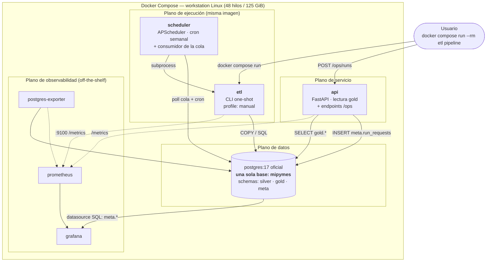

# Arquitectura objetivo — base única PostgreSQL, contenedores y observabilidad

Documento de arquitectura abierto el **2026-10-07**, rama `change-project-stucture`.
Define el estado objetivo y las fases para llegar ahí sin romper el pipeline
en el camino. Las decisiones de §3 están **cerradas**: este documento dice
cómo implementarlas, no si conviene hacerlas.

Complementa, no reemplaza:
- `plan.md` — plan algorítmico de resolución CLEE (ortogonal a esto).
- `AGENTS.md` — guía de desarrollo canónica; se actualiza al cierre de cada fase.
- `docs/entorno_linux.md` — inventario de la workstation de corridas reales
  y la configuración de Postgres derivada de él.

---

## 1. Diagnóstico: qué es exactamente lo que no escala

No es una intuición, son cuatro hechos medibles sobre el repo de hoy.

**1.1 — Gold todavía no existe; hoy es un placeholder.**
`src_etl/loaders/loader.py` "promueve" Silver a Gold copiando el archivo
`.duckdb`, con el mismo esquema y los mismos 13 objetos, porque **la capa
Gold aún no está diseñada**. El estado real de `data/gold/`:

| Archivo | Tamaño | Qué contiene |
|---|---:|---|
| `mipymes.duckdb` | 212 MB | Placeholder de una corrida parcial: 365,674 de 82.9M establecimientos, `entidades_economicas` **0 filas**, `sesnsp_incidencia_municipal` 0. Solo los catálogos están poblados. |
| `denue.duckdb` | 20 GB | Artefacto obsoleto (marzo 2026): 76.7M filas con el esquema anterior — sin estratos, sin tipos de vialidad/asentamiento, sin SESNSP. |

Esto no es un defecto de diseño que haya que arreglar, es trabajo
pendiente — y cambia la conclusión en la dirección útil: **no hay datos de
Gold que migrar.** La capa se diseña por primera vez, directo en Postgres,
sin deuda que arrastrar (Fase 5). Y el argumento de la base única se vuelve
más simple de lo que parecía: no se trata de consolidar dos bases que
funcionan, sino de no crear una segunda base para una capa que todavía no
nace.

**1.2 — La unidad de recuperación es el warehouse completo.**
Lo dice el propio historial (`cea2a9a`): un OOM a media carga dejó filas
parciales, corrompió el índice ART de la PK, el reintento incremental remató
la base y la única salida fue reconstruir ~8 h desde Bronze. `backup.py`
existe para mitigar eso con un clon APFS copy-on-write, lo cual funciona pero
es un parche sobre el problema real: **DuckDB commitea por archivo, no por
transacción de negocio**, así que un fallo a la mitad no se puede deshacer.

**1.3 — Hay cuatro archivos de base, no dos.**
`data/silver/mipymes.duckdb` (49.6 GiB), los dos de `data/gold/` descritos
en 1.1 (20.2 GB, ninguno utilizable) y `data/metadata.duckdb` (3.3 GB) con
su propio DDL en strings (`src_metadata/schema.py`, 451 líneas de SQL crudo
sin ORM ni migraciones). Cuatro archivos, cuatro ciclos de vida, cero
integridad referencial entre ellos: una corrida registrada en metadata puede
apuntar a filas que ya no existen en Silver y nada lo detecta.

**1.4 — El API importa del ETL.**
`src_api/main.py` importa `src_etl.core.config` y `src_etl.db`. Para servir
una consulta HTTP se arrastra Selenium, Polars, rapidfuzz y la configuración
de ingest. No se puede desplegar el API sin desplegar el ETL.

**Escala actual**, para dimensionar cualquier decisión de aquí en adelante:

| Objeto | Valor |
|---|---:|
| `establecimientos` | **82,896,801 filas** × 43 columnas |
| `sesnsp_incidencia_municipal` | 30,755,928 filas |
| `entidades_economicas` | **0 filas** — declarada, pendiente de construir; será `gold.establecimientos` (§2.3.1) |
| Periodos (cortes DENUE) | 20 |
| Datos reales en bloques DuckDB | 28.7 GiB |
| Archivo Silver | 49.6 GiB |
| Disco libre en la Linux | 844 GB |

---

## 2. Arquitectura objetivo

### 2.1 Vista de contenedores



Siete servicios, de los cuales **solo tres contienen código nuestro**
(`etl`/`scheduler` comparten imagen, y `api`). Prometheus, Grafana y
postgres-exporter son imágenes oficiales configuradas por archivo.

### 2.2 Respuesta directa a "¿contenedor aparte para monitoreo?"

Tu intuición del "servicio dedicado a metadatos" era correcta, pero **no
necesita ser un contenedor**. Se parte en dos piezas con responsabilidades
distintas:

| Pieza | Qué responde | Dónde vive | Contenedores extra |
|---|---|---|---:|
| **Metadatos / linaje** | ¿Qué corrió, cuándo, con qué resultado, qué filas produjo, de qué archivo vinieron? | Schema `meta` en la **misma** base + endpoints `/ops` en el API | **0** |
| **Métricas técnicas** | ¿Cuánta RAM/CPU/IO consume ahora? ¿cuántas filas/s? ¿el API responde? | Prometheus (scrape) → Grafana | 3 |

Por qué así y no un microservicio de metadatos: el historial de corridas
**debe** poder hacer JOIN con los datos que describe (`meta.process_tasks`
→ `silver.establecimientos` por periodo). Si vive en otra base, ese JOIN
no existe y vuelves al problema 1.3. Y por qué Prometheus aparte: porque
retener series temporales es un problema resuelto y meterlo en Postgres
sería reinventarlo peor.

### 2.3 Los tres schemas

Una base `mipymes`, tres schemas, tres contratos distintos:

```
silver.*     datos limpios, granularidad de origen, append por periodo
  establecimientos            82.9M filas, PARTICIONADA por period
  denue_actividades_economicas, denue_estratos_personal,
  denue_tipos_vialidad, denue_tipos_asentamiento,
  denue_tipos_unidad_economica, denue_entidades,
  denue_municipios, denue_localidades       ← catálogos (seeds)
  sesnsp_delitos, sesnsp_incidencia_municipal

gold.*       datos de consumo, derivados, lo que lee el API
             — SE CONSTRUYE POR PRIMERA VEZ (§1.1, Fase 5)
  establecimientos            MISMO NOMBRE que en silver, OTRO grano:
                              una fila por negocio resuelto (10.45M), no
                              por observación. Vista materializada.
                              Hoy existe como silver.entidades_economicas
                              con 0 filas (ver §2.3.1)
  + agregados y vistas materializadas que hoy no existen

meta.*       observabilidad y control
  job_runs, download_tasks, process_tasks, normalize_tasks,
  clee_resolution_tasks, data_lineage      ← hoy en metadata.duckdb
  schedules, run_requests                  ← nuevos (§2.5)
```

Ganancias concretas de usar schemas y no prefijos:

```sql
GRANT SELECT ON ALL TABLES IN SCHEMA gold TO api_ro;   -- el API no ve silver
pg_dump -n gold mipymes > gold.sql         -- respaldo de una capa sola
SET search_path = gold;                    -- UN schema a la vez (§2.3.1)
```

El API corre con un rol `api_ro` que **solo** tiene `SELECT` en `gold` y
`meta`. Un bug en un endpoint no puede tocar Silver. Eso con prefijos en
`public` no se puede expresar.

#### 2.3.1 Regla de nombres: `silver.establecimientos` vs `gold.establecimientos`

Decidido el 2026-10-07: la tabla de consumo se llama `establecimientos` en
`gold`, igual que en `silver`, porque el schema ya dice de qué capa se
habla. Es el patrón medallion habitual (`silver.orders` → `gold.orders`).

Pero aquí hay una diferencia que el patrón habitual no tiene: **el grano
cambia**. No es la misma tabla más limpia, es otra unidad de análisis.

| | Filas | Una fila es | N del estudio |
|---|---:|---|---|
| `silver.establecimientos` | 82,896,801 | una **observación**: (negocio, periodo) | — |
| `gold.establecimientos` | 10,450,524 | un **negocio** con su ventana de vida | ✅ |

El riesgo concreto: con `search_path = gold, silver`, la consulta
`SELECT count(*) FROM establecimientos` devuelve 10.45M o 82.9M según el
orden del `search_path`, **sin error ni aviso**. Y confundir esas dos N es
exactamente el sesgo de longitud documentado en la Fase 5 — el error que
más daño le haría a la tesis.

Tres salvaguardas, en orden de fuerza:

1. **Nunca un `search_path` con más de un schema de datos.** El default del
   rol `etl_rw` es `search_path = ''` (vacío): obliga a calificar
   `silver.establecimientos` / `gold.establecimientos` en todo el código del
   ETL. Un nombre sin calificar deja de compilar en vez de resolver mal.
2. **El rol `api_ro` solo tiene `GRANT` en `gold` y `meta`.** Para el API la
   ambigüedad no existe: `establecimientos` solo puede ser una cosa. Esta
   salvaguarda es estructural, no de disciplina.
3. **`COMMENT ON TABLE` en las dos**, declarando el grano. Aparece en `\d+`
   y en cualquier cliente SQL, que es donde ocurriría la confusión en una
   consulta ad-hoc de análisis.

Alternativa descartada: nombrar la de gold por su grano (`gold.negocios`,
`gold.establecimientos_resueltos`). Hace imposible la confusión sin
depender de salvaguardas, a cambio de romper la simetría entre capas. Queda
anotada por si la salvaguarda 1 resulta incómoda en la práctica.

### 2.3.2 Presupuesto de CPU y RAM

Cuestionado el 2026-10-07 ("¿en contenedor ya no vale la pena usar todos los
núcleos?"). La respuesta es la inversa de lo que sugiere la intuición.

Un contenedor **no** limita la CPU por sí mismo: sin `--cpus` ni
`--cpuset-cpus`, los procesos del contenedor son procesos del kernel host y
ven todos los núcleos. El overhead de CPU de contenerizar es
esencialmente cero. Lo que sí limita, y mucho, es la **VM Linux** que hace
falta para correr contenedores en macOS — y que en Linux no existe.

**El pipeline corre 100% en la workstation Linux** (decidido el 2026-10-07).
No hay VM: cgroup v2 actúa directo sobre el kernel del host, el contenedor ve
los 48 hilos y los 125 GiB sin pedir nada, y el IO de `pgdata` es nativo.
Las Mac quedan fuera del entorno de ejecución — a lo sumo se edita código en
ellas.

El inventario completo de la máquina, con la configuración de Postgres
derivada de él, está en **`docs/entorno_linux.md`**. Lo relevante aquí:

- **Threadripper 7960X (24 núcleos / 48 hilos) y 125 GiB de RAM.** No hay
  escasez que racionar.
- **125 GiB de RAM contra una base de ~130 GiB**: el warehouse cabe casi
  entero entre `shared_buffers` (32 GB) y el page cache del kernel, así que
  el IO deja de dominar tras la primera pasada.
- **ext4 sobre NVMe, `/var/lib/docker` en la partición de 1.7 TB con 844 GB
  libres.** Los dos riesgos de almacenamiento que había que descartar
  —copy-on-write de btrfs/zfs sobre `pgdata` y `/var` en partición chica— no
  aplican.
- **Usuario en el grupo `docker`, sin acceso root, y el plan no lo
  necesita.** Verificado: los tres sysctl candidatos no afectan a este
  workload, y `shm_size` se configura por contenedor (§4 de
  `docs/entorno_linux.md`).

**Reparto entre contenedores.** Antes había un solo proceso Python dueño de
la máquina; ahora `etl` y `postgres` comparten CPU. Con 48 hilos los límites
son contención —que un proceso desbocado no tumbe la máquina— no
racionamiento. Valores en `.env` (§6), no fijos en el compose:

| Servicio | `cpus` | `mem_limit` | `shm_size` |
|---|---:|---:|---:|
| `postgres` | 32 | 48g | **1g** |
| `etl` / `scheduler` | 16 | 32g | 2g |
| `api` | 4 | 4g | — |
| observabilidad | 2 | 4g | — |

El oversubscribe de CPU (54 sobre 48) es intencional: `etl` y `postgres` no
saturan a la vez — mientras uno transforma, el otro espera.

**Entonces, ¿sigue valiendo la pena el esfuerzo de paralelizar?** Sí, pero
se muda de lugar:

| | Antes (DuckDB embebido) | Ahora (Postgres en contenedor) |
|---|---|---|
| SQL pesado | `DUCKDB_THREADS` en el proceso Python | `max_parallel_workers` del servidor Postgres |
| Matching CLEE | Polars + rapidfuzz multihilo | **Igual** — sigue en Python, la regla no cambia |
| Límite real | RAM del host (36 GB, Mac) | 125 GiB y 48 hilos, sin intermediarios |
| Atención nueva | — | Repartir entre servicios, no un proceso que lo toma todo |

La premisa de optimización de `AGENTS.md` (tiempo **y** RAM a la vez) sigue
vigente sin cambios.

### 2.3.3 Notas de entorno: el Dockerfile y la GPU

**El `Dockerfile.etl` instala Chrome desde el repo de Google con
`[arch=amd64]` hardcodeado** (línea 11). Corriendo solo en Linux amd64 eso
**funciona**, así que no es un bloqueo — pero conviene cambiarlo a
`chromium` + `chromium-driver` de Debian por tres razones menores:
una dependencia externa menos (el repo de Google y su llave GPG), imagen más
chica, y portabilidad gratis si algún día hace falta. Chromium solo se usa
en el scraping de DENUE (`utils/browser.py`, `utils/denue_scraping.py`), que
no depende de nada específico de Chrome. **Prioridad baja.**

Con un solo entorno amd64, `buildx` multi-plataforma y la portabilidad de
`pgdata` entre arquitecturas dejan de ser temas.

#### ¿Sirve la RTX 5090?

Para esta arquitectura, **no**. Conviene decirlo claro para no basar
decisiones en ella:

- **Postgres no usa GPU.** No hay aceleración GPU para ejecución SQL en
  Postgres (PG-Strom existe, es nicho y frágil; no es una opción aquí).
- El resto del pipeline es CPU puro: Polars (SIMD), rapidfuzz (SIMD), H3,
  `COPY`. Nada de eso tiene ruta GPU.
- El cuello de botella real de este ETL es **IO y RAM**, no cómputo
  flotante. Una GPU no mueve ninguna de las dos.

**Donde sí serviría es en `plan.md`, no aquí.** El plan algorítmico sitúa el
techo de mejora en un *scorer aprendido* (98.70% proyectado contra 97.72%
actual) sobre los 9,002 `falso_match` donde alguna feature difiere. Eso sí
es trabajo de GPU:

- Entrenar el scorer (XGBoost/LightGBM con CUDA, o una red pequeña).
- Embeddings de nombres de negocio para los casos donde el nombre difiere
  pero el negocio es el mismo — es la señal que al scorer actual le falta.

Nota técnica si se llega a eso: la RTX 5090 (32 GB VRAM, driver 595.84) es
**Blackwell sm_120** y requiere builds recientes de PyTorch/XGBoost
(CUDA 12.8+); versiones anteriores no reconocen la arquitectura y fallan al
inicializar. Para la
GPU en Docker hace falta `nvidia-container-toolkit` y `gpus: all` en el
servicio — pero eso pertenece a un contenedor de entrenamiento aparte, no
al `etl`, que no debe cargar CUDA para hacer `COPY`.

### 2.4 Particionado: la unidad de recuperación pasa a ser el periodo

`silver.establecimientos` se declara particionada por rango sobre `period`,
una partición por corte (20 hoy, ~2 nuevas al año):

```sql
CREATE TABLE silver.establecimientos (...) PARTITION BY RANGE (period);
CREATE TABLE silver.establecimientos_2026_05
    PARTITION OF silver.establecimientos
    FOR VALUES FROM ('2026-05-01') TO ('2026-06-01');
```

Esto es la respuesta directa al incidente de `cea2a9a`:

- Cargar un corte nuevo **no toca** las 20 particiones existentes.
- Un fallo a media carga se deshace con `DROP TABLE ...2026_05` o un
  `ROLLBACK` — segundos, no 8 h de rebuild.
- Los índices se crean por partición, después del `COPY`, con
  `CREATE INDEX CONCURRENTLY`.
- `VACUUM`/`ANALYZE` por partición, no sobre 82.9M filas.
- Las consultas por periodo hacen *partition pruning* automático.

El patrón de carga pasa a ser: `COPY` a una tabla `UNLOGGED` de staging →
validar → `ATTACH PARTITION` → indexar. Si algo falla, la staging se tira
y Silver nunca vio datos parciales. **`backup.py` deja de ser necesario**
(§Fase 9).

### 2.5 Ejecución: semanal automática + manual

Tres formas de disparar una corrida, una sola ruta de ejecución:

```
  cron semanal (scheduler)  ─┐
  POST /ops/runs (API)      ─┼──> meta.run_requests ──> scheduler toma ──> src.etl.main
  docker compose run --rm etl pipeline (CLI)       ─┘      (cola en la DB)      el advisory lock
                                                          de Postgres
```

**Por qué una cola en tabla y no el socket de Docker:** el API nunca
necesita permisos de Docker (un endpoint con acceso al socket es acceso root
al host). El API solo hace `INSERT`; el `scheduler` consulta la cola cada
`SCHEDULER_POLL_SECONDS` y ejecuta.

**Exclusión mutua con `pg_advisory_lock`.** El pipeline completo dura horas.
Antes de arrancar, toda corrida toma `pg_try_advisory_lock(hashtext('etl_pipeline'))`;
si no lo obtiene, se registra como `SKIPPED` con la razón y el `run_id` que
está ocupando el lock. Esto cierra dos agujeros reales de hoy:

- Dos `--force` seguidos pisando el respaldo bueno (el incidente que ya
  tienes documentado en las reglas del proyecto).
- Un tick semanal arrancando sobre una corrida manual todavía viva.

**Nota de diseño sobre la frecuencia semanal.** DENUE publica ~2 cortes al
año y SESNSP uno al mes, así que un cron semanal no es "procesar datos
nuevos cada semana": es **"revisar si hay algo nuevo cada semana"**. El modo
incremental ya existente hace exactamente eso — si no hay corte nuevo, el
extract no descarga nada, los stages no tienen periodos pendientes y la
corrida cierra en segundos con `tasks_skipped = N`. Esa corrida vacía
semanal tiene valor propio: es un *canario* que detecta que INEGI cambió la
estructura de su sitio o que SESNSP movió el recurso CKAN, meses antes de
que lo necesites para un corte real.

Default propuesto: `ETL_SCHEDULE_CRON="0 3 * * 1"` (lunes 3:00). Configurable
en `.env`; `ETL_SCHEDULE_ENABLED=false` lo apaga sin tocar el compose.

### 2.6 Estructura de paquetes

```
src/
  shared/              # ← sin dependencias sobre etl/api/scheduler
    enums/
      __init__.py      # re-exporta todo
      layer.py         # Layer: SILVER | GOLD | META
      jobs.py          # JobType, JobStatus, TaskStatus, TriggerType, ErrorType
      sources.py       # SourceSystem: DENUE | SESNSP
      sections.py      # Section (hoy enum local en src_etl/main.py)
    config.py          # Settings  (hoy src_etl/core/config.py)
    logging.py         # get_stage_logger  (hoy src_etl/core/logging.py)
    db/
      base.py          # DeclarativeBase + naming_convention
      session.py       # engine, sessionmaker, get_db
      models/          # ORM por schema: silver.py, gold.py, meta.py
  etl/                 # extractors, transformers, loaders, utils
  api/                 # routers, schemas, deps
  scheduler/           # cron + consumidor de cola
  meta/                # MetadataTracker sobre ORM
```

El criterio es el de `mp-backend/app/shared/enums/business.py`, y su
docstring lo dice mejor que cualquier regla: *"Lives in `shared` because
both modules need it without taking a cross-module dependency on each
other."* Hoy `JobStatus` vive en `src_metadata/models.py` y `Section` en
`src_etl/main.py`; el `scheduler` necesitaría los dos, y el API necesita
`JobStatus` para serializar `/ops/runs`. Con el paquete `shared`, ninguno
importa del otro.

Los enums siguen el mismo patrón `str, Enum` + docstring que explica el
dominio y por qué está compartido:

```python
class Layer(str, Enum):
    """Capas del warehouse, una por schema de Postgres.

    Compartido entre el ETL (que escribe silver y deriva gold), el API
    (que solo lee gold) y el tracker de metadatos (que etiqueta cada
    tarea con la capa que tocó). Vive en `shared` porque los tres lo
    necesitan sin dependerse entre sí.

    El valor es literalmente el nombre del schema: se usa en
    `search_path`, en los GRANT por capa y en los nombres calificados,
    así que cambiar un valor renombra un schema.
    """

    SILVER = "silver"
    GOLD = "gold"
    META = "meta"
```

---

## 3. Decisiones cerradas

| # | Decisión | Por qué |
|---|---|---|
| D1 | **Schemas nativos** (`silver.`, `gold.`, `meta.`), no prefijos | Da lo mismo que un prefijo al leer, y además `search_path`, `GRANT` por capa y `pg_dump -n`. §2.3 |
| D2 | **PostgreSQL puro** para los pasos pesados; DuckDB sale del runtime | Decisión cerrada, no sujeta a revisión. Cómo se implementa: §4 |
| D3 | **`src/{shared,etl,api,scheduler}`** con paquete `shared` | Rompe el acoplamiento `api → etl` del diagnóstico 1.4. §2.6 |
| D4 | **`meta` en la misma base + Prometheus + Grafana** | Metadatos con JOIN a los datos que describen; series temporales donde ya están resueltas. §2.2 |
| D5 | **Cron semanal en contenedor `scheduler` + cola en tabla + advisory lock** | Manual y automático por la misma ruta; el API nunca toca el socket de Docker. §2.5 |
| D6 | **`establecimientos` particionada por `period`** | La unidad de recuperación pasa de 49.6 GiB a un corte. §2.4 |
| D7 | **La tabla de gold se llama `establecimientos`**, no `entidades_economicas` | El schema ya distingue la capa; el grano distinto se protege con tres salvaguardas. §2.3.1 |
| D8 | **Solo se migra el código.** Sin retrocompatibilidad, sin migración de datos; el proyecto de la Mac queda intacto | El pipeline nuevo arranca en limpio: `docker compose run --rm etl extract` re-descarga Bronze (el scraping recorre el histórico completo de INEGI) y los seeds están en git. Ningún insumo hay que trasladar ni respaldar. §5 |
| D9 | **El pipeline corre 100% en la workstation Linux**; las Mac quedan fuera de la ejecución | Threadripper 7960X (48 hilos) + 125 GiB + NVMe, sin VM intermedia. Un solo entorno amd64: nada de multi-arch ni límites por máquina. Inventario en `docs/entorno_linux.md`. La GPU no participa. §2.3.2, §2.3.3 |

---

## 4. Cómo se implementa sobre Postgres

Postgres es el motor (D2). Esta sección no evalúa esa decisión: recoge lo
que hay que hacer distinto para que el pipeline funcione bien sobre un motor
orientado a filas, y qué módulos toca.

### 4.1 — Disco: presupuestar ~130 GiB

Postgres almacena por filas, sin compresión de columna, con ~24 B de
overhead por tupla sobre 82.9M filas. Presupuesto de trabajo: **~130 GiB**
para la tabla más índices, más 9.1 GiB de Bronze.

Contra los **844 GB libres** de la Linux sobra espacio, y **no hay nada que
borrar**: el proyecto de la Mac queda intacto y no participa (§5).

Dos cosas que ayudan al presupuesto y conviene hacer de entrada:

- Tipos compactos en las 43 columnas: `char(n)` para claves INEGI, `int`
  donde hoy hay texto, y revisar candidatas a eliminar.
- `pgdata` en **volumen nombrado**. Vive en `/var/lib/docker/volumes`, la
  misma partición ext4 de 1.7 TB.

### 4.2 — Escrituras masivas: `INSERT` + swap en vez de `UPDATE`

En Postgres un `UPDATE` reescribe la tupla completa (MVCC) y genera WAL e
hinchazón, así que las pasadas masivas se escriben distinto a como están
hoy:

- `UPDATE` acotado a una partición (~4M filas), nunca a la tabla entera.
- Donde se pueda, `INSERT` a tabla nueva + swap de partición en vez de
  `UPDATE` in-place: evita el bloat por completo. Es el patrón para las dos
  resoluciones CLEE.
- `maintenance_work_mem` alto y `synchronous_commit=off` durante las cargas;
  `CREATE INDEX CONCURRENTLY` después del `COPY`, no antes.
- **`normalize-dates` desaparece como stage.** Con `COPY` desde Polars la
  fecha se normaliza antes de entrar, así que no hace falta un `UPDATE`
  posterior sobre 82.9M filas. Un stage menos.

### 4.3 — Lo que se gana: transacciones reales

El incidente de `cea2a9a` **no puede repetirse**. Un fallo a media carga
hace `ROLLBACK` o deja la staging huérfana; Silver nunca queda con filas
parciales ni índices corruptos. Junto con el particionado (§2.4), la unidad
de recuperación pasa de 49.6 GiB a un corte.

### 4.4 — H3 se calcula en Python, no en SQL

**Decidido el 2026-10-07.** Hoy dos funciones SQL de la extensión h3 de
DuckDB materializan las columnas `h3_cell_9` y `h3_cell_5` (BIGINT):
`h3_latlng_to_cell` y `h3_cell_to_parent`, en `transformers/h3_backfill.py`
y `loaders/denue.py`. Postgres no las tiene.

De las dos rutas posibles —extensión **h3-pg** (imagen custom de Postgres,
SQL casi idéntico) o **calcular en Python** antes del `COPY`— se elige
**Python**:

- El proyecto **ya usa la API de enteros de h3-py**:
  `from h3.api import basic_int as h3i` (`utils/matching.py:200`). Misma
  librería, devolviendo exactamente el `BIGINT` que la columna almacena. No
  hay conversión hex→int ni riesgo de divergencia de valores.
- Las dos columnas se **materializan una vez al ingestar**; no se consultan
  dinámicamente. La función no hace falta en SQL.
- Los índices sobre `h3_cell_9` son B-tree sobre `BIGINT`: no requieren la
  extensión.
- Postgres queda con la **imagen oficial**, sin build propio que mantener.
- El único caso que pediría h3-pg sería hacer `h3_grid_disk` ad hoc en SQL,
  y hoy el blocking del matching ya corre en Python.

**Consecuencia: el stage `h3-cells` desaparece.** `h3_backfill.py` (286
líneas) existe solo para llenar por `UPDATE` las celdas de filas ya
cargadas. Si el `COPY` las trae calculadas, no hay nada que backfillear.
Es el segundo stage que se elimina después de `normalize-dates`, y por la
misma razón: ambos eran `UPDATE` masivos sobre 82.9M filas, el patrón que
§4.2 evita.

Las resoluciones (`H3_BLOCKING_RES = 9`, `H3_PARTITION_RES = 5`) siguen
siendo constantes estructurales en `utils/clee_resolution_config.py`, no
variables de entorno — su docstring ya explica por qué.

### 4.5 — Superficie de reescritura

Lo que toca la Fase 4:

| Módulo | Líneas | Qué hay que cambiar |
|---|---:|---|
| `src_metadata/tracker.py` | 1276 | SQL DuckDB crudo → ORM sobre `meta` |
| `utils/entity_resolution.py` | 822 | Solo las lecturas; la lógica de matching **no se toca** |
| `transformers/clee_resolver.py` | 664 | `connect_configured` → sesión; `UPDATE` por partición |
| `transformers/processor.py` | 495 | `read_csv` → Polars + `COPY`; `QUALIFY` → CTE |
| `transformers/denue.py` | 454 | Orquestación de stages |
| `src_metadata/schema.py` | 451 | **Se elimina**: lo reemplaza Alembic |
| `transformers/date_normalizer.py` | 370 | **Se elimina**: la fecha se normaliza en el `COPY` (§4.2) |
| `transformers/sesnsp.py` | 353 | `read_csv` → `COPY` |
| `transformers/h3_backfill.py` | 286 | **Se elimina**: H3 se calcula en el `COPY` (§4.4) |
| `db/indexes.py` | ~200 | `duckdb_indexes()` → `pg_indexes`; mismo contrato |
| `loaders/*.py` | ~800 | `read_parquet` → `COPY`; `loader.py` se elimina (Fase 5) |
| `utils/backup.py` | 159 | **Se elimina** (Fase 9) |

Punto clave: **la lógica de matching CLEE validada al 97.72% F1 no se
toca.** Opera sobre DataFrames de Polars, no sobre SQL. Lo que cambia es de
dónde se leen esos DataFrames. Eso es lo que hace la Fase 4 ejecutable sin
arriesgar el resultado algorítmico de la tesis.

---

## 5. Fases

Cada fase es independientemente verificable y deja el repo funcionando.

**Premisa simplificadora (2026-10-07): solo se migra el código.** El proyecto
actual de la Mac —con sus 49.6 GiB de Silver y su metadata— **se queda tal
como está y no participa**. El trabajo de aquí en adelante es exclusivamente
código: el pipeline nuevo arranca en limpio en la workstation Linux y se
reconstruye desde cero.

Eso elimina del plan la migración de datos, el descarte de los `.duckdb`, la
coexistencia de ambos motores y el "punto de no retorno". No hay nada que
trasladar ni que respaldar:

| Insumo | Cómo llega a la Linux |
|---|---|
| **Bronze** (9.1 GiB, 484 ZIPs) | `docker compose run --rm etl extract` lo descarga. El scraping lee **toda** la tabla `tblDescargaArchivos_denue` de INEGI sin filtrar por periodo: de ahí salieron los 20 cortes actuales (2015 → 2026-05), así que el histórico sigue publicado |
| **`data/seeds/`** (456 KB) | **Versionado en git** — 9 parquet trackeados; llega con el `git clone` |
| **`data/eval/`** (584 MB) | Se regenera con `docker compose run --rm tools python scripts/evaluate_masked_clee.py extract` desde el Silver nuevo |

Los números de referencia para verificar la reconstrucción ya están escritos
en este documento (§1 y §Fase 4), así que tampoco hay que extraer un baseline
antes de empezar.

> Corrección a versiones anteriores de este documento: se afirmó que INEGI
> retira cortes viejos y que Bronze era irreemplazable. **Es falso** — la
> tabla de descargas expone el histórico completo y el extractor lo recorre
> entero.

### Fase 0 — Preparación

Corta. El entorno de ejecución ya está listo (inventario del 2026-10-07 en
`docs/entorno_linux.md`: Docker 29.2.1 nativo, cgroup v2, usuario en el grupo
`docker`, ext4 sobre NVMe con 844 GB libres, sin ajustes de root pendientes),
y **no hay datos que trasladar ni preparar** — ver el recuadro de §5.

- [ ] Clonar el repo en la Linux. Los seeds vienen con él (9 parquet
      versionados en `data/seeds/`).
- [x] Declarar `cpus`, `mem_limit` y `shm_size` por servicio en el compose
      (§2.3.2) y `POLARS_MAX_THREADS` en el ETL.
- [ ] Opcional, prioridad baja: `chromium` en vez de `google-chrome-stable`
      en `Dockerfile.etl` (§2.3.3). En amd64 el actual funciona.

**Regla de ejecución (2026-10-19): todo corre en contenedor, sin
excepciones.** No hay Makefile ni ejecución nativa en ninguna máquina;
`docker-compose.yml` es la única interfaz. Tres cambios:

- **Chrome sale de la base de la imagen.** Lo usan dos archivos
  (`utils/browser.py`, `utils/denue_scraping.py`), ambos del scraping de
  DENUE. Tenerlo abajo obligaba a que migraciones y tests cargaran un
  navegador amd64 de ~500 MB que no usan, y volvía la imagen inconstruible
  en arm64 — o sea, en la máquina de desarrollo. Ahora `Dockerfile.etl`
  tiene dos targets: `tools` (portable) y `etl` (= base + Chrome, amd64).
- **La orquestación vive en el compose.** `migrate` es un servicio one-shot
  encadenado con `service_completed_successfully`, así que
  `docker compose up -d` espera el healthcheck de Postgres, aplica el
  baseline y deja la base lista. Un comando, no una secuencia que alguien
  tenga que recordar.
- **Se elimina el `Makefile`.** La versión anterior de esta sección proponía
  un flag `DOCKER=1` que eligiera entre `uv run` y `docker compose run`.
  Era una segunda fuente de verdad sobre una topología que el compose ya
  describe. Las ~139 referencias a `make X` en la documentación se
  migraron a su comando equivalente.

**Un bug que esto destapó:** `Dockerfile.etl` **nunca pudo construirse**.
Hacía `uv sync --group etl --frozen` y ese grupo no existe en
`pyproject.toml` — `uv` falla con "Group `etl` is not defined". Nadie lo
había notado porque la imagen jamás se había construido. Ahora es
`--frozen --no-dev`, que es lo que se quería decir. Segundo bug del mismo
tipo: el keyring de Chrome se escribía en `/etc/apt/keyrings`, que no
existe en `python:3.12-slim`.

Se agrega también un `.dockerignore`: sin él el contexto de build arrastra
`data/` (cientos de MB entre Bronze y eval) y `.venv` en cada `docker build`.

**Criterio de aceptación:** sobre un clon limpio, `docker compose build` y
`docker compose up -d` dejan la base migrada, y
`docker compose run --rm tools pytest` corre la suite — todo sin que exista
un intérprete de Python en el host.

### Fase 1 — Paquete `src/shared` ✅ COMPLETA (2026-10-08)

Refactor puro: **mismo motor, mismo comportamiento**, solo movimiento de
código. Ejecutada en cinco commits, cada uno con la suite completa como
verificación.

- [x] `src/shared/enums/` con `layer.py`, `jobs.py`, `sources.py`,
      `sections.py` — patrón `StrEnum` + docstring de dominio (§2.6).
      Nuevos: `Layer`, `SourceSystem`, `TriggerType`.
- [x] `config.py` y `logging.py` a `src/shared/` (22 imports).
- [x] `Base`, sesión (`database.py` → `session.py`), modelos y deps a
      `src/shared/db/`. `indexes.py` se queda en el ETL: solo lo usan
      `clee_resolver` y `processor`.
- [x] `src_etl` → `src/etl`, `src_api` → `src/api`, `src_metadata` →
      `src/meta`; con `pyproject.toml`, `pytest.ini`, `.coveragerc`,
      `Makefile` y `Dockerfile.etl`.
- [x] Enums duplicados eliminados: una sola definición, verificada por
      identidad de objeto (`meta.JobStatus is shared.JobStatus`).

**Criterio de aceptación — cumplido:**

- `217 passed, 23 skipped` en cada commit, igual que antes de empezar.
- `grep -r "from src.etl" src/api/` sin resultados: el acoplamiento del
  diagnóstico 1.4 está roto; el API solo importa de `shared`.
- `grep -r "from src.(etl|api|meta)" src/shared/` sin resultados: el
  paquete compartido no tiene dependencias salientes.
- Ruff: **44 errores, todos preexistentes** (32 `W293`, 10 `W291`, 2
  `F841`). Bajó de 47 porque los 3 `UP042` eran los `(str, Enum)` que la
  fase eliminó. Nota: el criterio original decía "`docker compose run --rm tools ruff check src/ tests/ scripts/ alembic/` limpio", que
  **no era alcanzable** — el repo ya tenía esos errores antes de la fase.
  Limpiarlos es trabajo aparte, no de esta migración.

**Tres bugs preexistentes o introducidos que la fase dejó a la vista:**

1. `Dockerfile.etl` copiaba `src/etl`, `src/meta` y `src/api` por separado,
   lo que habría dejado la imagen sin `src/shared`. Ahora copia `src/`.
2. `docker compose run --rm tools python -m src.etl.main status` importaba `DenueTransformer`, clase que no existe
   (es `DenuePipelineOrchestrator`); ya fallaba en `HEAD`.
3. `PROJECT_ROOT` de `main.py` usaba `parents[1]`, correcto en `src_etl/`
   pero no en `src/etl/`: apuntaba a `src/` y dejaba `BRONZE_DIR` en una
   ruta inexistente. Ningún test cubre `main.py`, así que habría aparecido
   como "no hay archivos que procesar" en la primera corrida real.

### Fase 2 — Postgres en contenedor y esquema objetivo ⚠️ CÓDIGO LISTO, VALIDACIÓN PENDIENTE (2026-10-08)

- [x] `docker-compose.yml` con el servicio `postgres` (imagen oficial, sin
      extensiones — §4.4), volumen nombrado, `shm_size`, healthcheck y el
      tuning de §2 de `docs/entorno_linux.md` como flags desde `.env`.
- [x] Roles: `etl_rw` (dueño) y `api_ro` (`SELECT` en `gold` y `meta`, más
      `DEFAULT PRIVILEGES` para las tablas futuras).
- [x] Alembic multi-schema: `include_schemas=True`, `include_name` limitado
      a los tres schemas, `version_table_schema="meta"`, un solo engine.
- [x] Modelos ORM en sus schemas. El schema va en el **MetaData**, no en
      cada modelo: así las ~20 FKs escritas sin calificar se resuelven
      solas dentro de `silver` y no hubo que reescribir ninguna.
- [x] Modelos ORM de `meta.*` (reemplazan `src/meta/schema.py`), ahora con
      FKs reales y `ON DELETE CASCADE`.
- [x] Baseline único `b0000baseline` en lugar de las 4 migraciones de
      DuckDB: crea los 3 schemas, 18 tablas, el rol de lectura y siembra.
- [x] **Un solo motor en la capa de configuración.** Fuera
      `DATABASE_BACKEND`, `SILVER_DATABASE_URL`, `_get_duckdb_url`,
      `DuckDBImpl` y las ramas por backend de `session.py` y `alembic/env.py`.
      Tener el flag era un riesgo real: con `DATABASE_BACKEND=duckdb`, el
      comando de migración aplicaba el baseline sobre el archivo local en
      vez de sobre el contenedor.
- [ ] **`establecimientos` particionada por `period`** — se pasa a la Fase 3,
      donde vive el helper de staging que la usa (§2.4).

**Verificado sin servidor:** 217 passed en cada commit; las 18 tablas del
baseline cubren exactamente el metadata (silver 12 / meta 6 / gold 0); el
DDL compilado contra el dialecto `postgresql` sale calificado
(`CREATE TABLE silver.establecimientos`, `REFERENCES meta.job_runs ... ON
DELETE CASCADE`); `_safe_identifier` rechaza
`"api_ro; DROP SCHEMA silver"`; ruff en los 44 preexistentes.

**⚠️ PENDIENTE — validar en la workstation Linux:**

```bash
cp .env.example .env     # y poner los dos passwords
docker compose build
docker compose up -d     # Postgres (healthcheck) → migrate (b0000baseline) → api
docker compose exec postgres psql -U etl_rw -d mipymes -c 'SHOW shared_buffers'
docker compose exec postgres psql -U etl_rw -d mipymes   # \dn → silver, gold, meta
```

Qué puede salir mal, por probabilidad:

1. **Los loaders de seeds contra Postgres.** `load_geografia`, `load_scian`,
   `load_dominios` y `load_estratos` corren dentro de la migración y nunca
   se han ejecutado sobre otro motor que DuckDB. Es el paso con más
   superficie de fallo del baseline.
2. **`shared_buffers=32GB`** no arranca si la máquina tiene menos RAM que
   eso disponible.
3. **Tipos sin equivalente exacto.** `Double` y `DateTime(timezone=True)`
   compilan bien, pero solo se han verificado compilando, no ejecutando.

**Qué quedaba de DuckDB.** Esta tabla se mantuvo mientras la migración
avanzaba; la Fase 4 la cerró por completo. No queda código que abra un
archivo de base de datos: `connect_configured`, `backup.py`, los seis stages
y las variables `DUCKDB_*` se eliminaron con sus últimos consumidores.

**De los tres andamios de transición** que esta fase introdujo a propósito,
dos se retiraron con la Fase 4: el `SET schema='silver'` de
`connect_configured` (el SQL de los stages ya va calificado) y el re-export
plano de los modelos. Queda el listener `before_create` que emite
`CREATE SCHEMA IF NOT EXISTS`, que es el que permite a los tests montar un
schema desechable sin pasar por Alembic.

### Fase 3 — Capa de acceso sin DuckDB ⚠️ CÓDIGO LISTO, VALIDACIÓN PENDIENTE (2026-10-19)

**El bloqueo era más chico de lo que decía este plan.** La versión anterior
afirmaba que había que migrar los 8 archivos de test antes de poder
particionar. Medido en el código, **solo 2 clases rompen**, no 8 archivos:
las únicas que llaman `create_all` con `tables_for(DEFAULT_SCHEMA)` —que
arrastra `establecimientos`— son `test_dominio_catalogs::TestEstablecimientoLinks`
y `test_indexes::TestCicloDeVida`. `test_seed_loaders` nombra sus tablas
(`denue_entidades`, …) y nunca crea la tabla de hechos, así que sobrevive
intacto; los otros 5 archivos usan `duckdb.connect` con SQL crudo y ni
siquiera pasan por el ORM.

Y dos de esos tests **no se migran, se borran**: `test_backup` prueba
`utils/backup.py`, que la Fase 9 elimina, y `test_indexes` prueba
`db/indexes.py`, que esta misma fase reescribe. Migrarlos antes era trabajo
destinado a la basura.

Orden ejecutado:

- [x] **1. Marcador `@pytest.mark.postgres` + skip condicional**, en lugar
      de la migración big-bang. `conftest.py` sondea el servidor una vez por
      sesión (`TEST_POSTGRES_URL`, con default derivado de `POSTGRES_*` más
      sufijo `_test`) y salta lo marcado si no responde. El suite queda
      verde y la deuda queda greppable, en vez de ser rojo que uno aprende a
      ignorar. Cada archivo se migra cuando se reescribe su sujeto.
- [x] **2. `establecimientos` particionada por `period`**, PK a
      `(id, period)`, helper en `src/shared/db/partitions.py`
      (`create_partition`, `detach_partition`, `drop_partition`,
      `existing_partitions`).

      **LIST y no RANGE**: cada corte es una fecha discreta (20 valores),
      así que LIST da exactamente una partición por corte —la unidad de
      recuperación de §2.4— y hace imposible que dos cortes caigan en la
      misma partición por un límite mal escrito. El pruning funciona igual.

      Se quitó el `index=True` de `period`: es la clave de partición, así
      que dentro de cada partición sería un índice sobre una columna
      constante — 20 árboles que mantener para cero selectividad.

      Verificado sobre el Silver real que la PK compuesta **no afloja la
      unicidad**: los 82,896,801 ids son distintos entre sí porque `id` es
      un hash del contenido de la fila. Lo que se pierde es la garantía
      *formal* entre periodos, y no hay manera de conservarla — Postgres
      tampoco admite un índice único global que excluya la clave de
      partición.
- [x] **3. `src/shared/db/copy.py`** — **decisión cerrada: CSV, no binario**,
      y psycopg3 igual.

      El planteamiento original tenía el cuello mal ubicado. El formato
      binario obliga a `copy.write_row(tupla)`, o sea un bucle Python sobre
      82.9M tuplas; CSV deja que Polars serialice el bloque entero en Rust
      multihilo y que psycopg mande los bytes de corrido. El cliente casi no
      participa y lo que se paga es el parseo del servidor, que es C.
      psycopg3 se adopta igual (psycopg2 está en modo mantenimiento y la
      API de bloques soporta ambos caminos si hay que medir).

      `quote_style="non_numeric"` no es cosmético: sin él Polars escribe
      NULL y cadena vacía idénticos, y los campos vacíos del DENUE se
      cargarían mal en silencio.
- [x] **4. `src/shared/db/staging.py`**: cargar en tabla suelta → validar →
      `ATTACH PARTITION`. El CHECK que replica el límite se agrega **antes**
      del attach: no ahorra trabajo total, pero mueve el escaneo a un
      momento en que no se tiene un `ACCESS EXCLUSIVE` sobre la tabla padre.

      **Divergencia del plan: la tabla de staging nace LOGGED, no UNLOGGED.**
      Una partición UNLOGGED hace a Silver no duradera, y evitarlo obliga a
      `SET LOGGED` antes del attach, que reescribe la tabla y vuelve a
      escribir todo el WAL que el UNLOGGED había ahorrado — los datos se
      escriben dos veces. El ahorro real en cargas masivas es
      `wal_level=minimal`, que es configuración del servidor, no código.
      Queda el parámetro `unlogged` para medirlo cuando haya servidor.
- [x] **5. `db/indexes.py` reescrito** sobre `pg_indexes`, conservando el
      contrato de `suspended_indexes()`. Soltar el índice del padre se lleva
      los de todas las particiones, así que drop/ensure quedan tan simples
      como antes. `CREATE INDEX CONCURRENTLY` **no funciona sobre el padre**:
      está implementado como `ensure_indexes(concurrently=True)`, que crea
      el del padre con `ON ONLY`, construye uno por partición y los engancha
      con `ALTER INDEX ... ATTACH PARTITION`. El default es el camino
      bloqueante, correcto dentro del ETL.
- [ ] **6. Retirar `connect_configured`** en favor de la sesión; conservar
      `get_distinct_periods` como consulta de catálogo. Depende de la Fase 4
      (los stages son sus únicos consumidores).

**Verificado sin servidor:** `205 passed, 35 skipped` (antes 217/23 — los 12
que se movieron son exactamente las 2 clases marcadas, cero fallos nuevos);
el DDL compilado sale con `PRIMARY KEY (id, period)` y
`PARTITION BY LIST (period)`; `duckdb_engine` sigue funcionando sin psycopg2
instalado (SQLAlchemy difiere la importación del DBAPI); ruff en los 44
preexistentes, cero nuevos.

**⚠️ PENDIENTE — nada de esto ha tocado un servidor.** Por orden de riesgo:

1. **`staging.py` completo.** `ATTACH PARTITION`, el CHECK previo y el
   rename no se han ejecutado nunca. Es el módulo con más superficie.
2. **`copy.py` y el round-trip de NULL vs `""`.** La hipótesis de que
   `quote_style="non_numeric"` + `FORMAT CSV` los distingue hay que verla
   cumplirse sobre datos reales del DENUE.
3. **`ensure_indexes(concurrently=True)`.** El baile `ON ONLY` + attach es
   el camino menos trillado del módulo.
4. **Los 2 bloques de tests marcados**, que siguen escritos contra DuckDB:
   al levantar Postgres hay que migrarlos, no solo dejar de saltarlos.

**Criterio de aceptación:** la suite corre contra Postgres,
`silver.establecimientos` tiene sus 20 particiones, y el contexto de
staging deja Silver intacta cuando la carga falla a la mitad.

### Fase 4 — Stages sobre Postgres ⚠️ CÓDIGO LISTO, VALIDACIÓN PENDIENTE (2026-10-20)

Ejecutada en seis commits. **No queda una sola línea que abra un archivo de
base de datos** — y no por reescribir comentarios, sino porque no queda
código que lo haga.

- [x] **`ingest`**: ZIP → Polars → `COPY` a staging → `ATTACH PARTITION`.
      **La unidad de carga pasó a ser el corte, no el archivo.** Un periodo
      son decenas de ZIP que juntos forman una partición; se leen todos, se
      concatenan y se enganchan de golpe. Un corte que falla no detiene a
      los demás: su partición no se enganchó, así que Silver sigue
      consistente.

      Consecuencia aceptada: `--force` opera por periodo. Reprocesar un ZIP
      suelto no tiene sentido si la partición se construye entera.

      Tampoco hace falta suspender índices durante la carga —se escribe en
      una tabla sin enganchar, que no tiene ninguno—, lo que elimina el otro
      gran motivo de complejidad del ingest viejo.
- [x] **`normalize-dates` y `h3-cells` se eliminan como stages.** Eran dos
      `UPDATE` sobre la tabla ya cargada: reescribir 82.9M filas dos veces
      después de escribirlas una. Ahora `transformers/enrich.py` las deriva
      antes del `COPY`, con los datos todavía en memoria. Son funciones
      puras, así que sus 37 tests corren sin servidor — importa, porque ahí
      vive la interpretación de los seis formatos de fecha de INEGI y un
      formato mal leído no da error: da 14.5M de fechas en NULL.
- [x] **`clee-resolution-radio` y `clee-resolution-h3`**: solo se migró la
      capa de acceso. **La lógica de matching no se tocó**, byte por byte.
      Fue posible porque la frontera ya estaba limpia: diez métodos tocaban
      la base y el resto es Polars y numpy.

      El `UPDATE` masivo va por tabla temporal + `COPY` + `UPDATE ... FROM`,
      y **lleva el periodo en el `WHERE`**: sin él recorrería las veinte
      particiones para tocar una.
- [x] **`sesnsp`**: el unpivot ancho→largo pasa de SQL de DuckDB a Polars.
      La tabla se sigue reconstruyendo completa —cada corte revisa cifras
      históricas— pero ahora el `DELETE` y el `COPY` van en una transacción.
- [x] **`build-entidades`**: la dimensión N3 sobre Postgres. `DELETE` +
      `INSERT` en vez de `DROP` + `CREATE`, porque dropear la tabla la
      recrearía sin los índices de la migración.
- [x] **Mantener el contrato del CLI**, con dos cambios obligados: ya no hay
      secciones `normalize-dates` ni `h3-cells` (no existen los pasos), y
      `load` se retira hasta que la Fase 5 defina qué significa derivar Gold.
      `pipeline` pasa a ser una etapa, no dos.
- [ ] **Reconstrucción completa desde Bronze**, los 20 periodos. Con `nohup`
      o `systemd-run --user` para que sobreviva al cierre de la sesión SSH.

**Lo que se eliminó por quedarse sin consumidor:**

| Qué | Por qué |
|---|---|
| `utils/warehouse.py` | `connect_configured` y compañía: el último punto donde se abría un archivo |
| `utils/backup.py` | respaldaba el archivo antes de cada etapa. Con transacciones reales, una etapa que falla no deja nada que restaurar |
| `loaders/denue.py` | el `INSERT` fila por fila con upsert |
| `loaders/loader.py` | el `load` copiaba un archivo que ya no existe |
| `transformers/date_normalizer.py`, `h3_backfill.py` | 649 líneas de `UPDATE` que `enrich.py` hace en vuelo |
| 7 campos de `Settings` | `SILVER_DUCKDB_PATH`, `GOLD_DUCKDB_PATH`, `DUCKDB_THREADS`, `DUCKDB_MEMORY_LIMIT`, `WAREHOUSE_BACKUP_ENABLED`, `SILVER_DIR`, `GOLD_DIR` |

Lo único que sigue siendo archivo es la **entrada**: los ZIP de Bronze y los
seeds versionados.

**Los dos scripts de verificación también se migraron**, que importa porque
son el juez de la fase: `eval-masked-clee` mide el 97.72% F1 y
`propagation-stats` la cobertura de identidad. `propagation-stats` pierde
`--db`: aceptaba un archivo o un parquet, y con una sola Silver en un
servidor la fuente dejó de ser un parámetro.

**Verificado contra PostgreSQL 17 real:** 325 passed, 0 skipped. La suite
completa bajó de 58s a 14s al dejar de levantar bases en memoria.

**⚠️ PENDIENTE:** nada de esto ha procesado un ZIP real. Falta el criterio
de aceptación, que requiere Bronze completo.

**Criterio de aceptación — qué significa "correcto" corriendo en limpio.**
No hay DuckDB de referencia al lado (el proyecto de la Mac se queda intacto
pero no participa), así que no hay `diff` fila a fila. La verificación se
apoya en los números ya documentados en este plan y en el eval del
algoritmo:

1. **Conteos que deben cuadrar exactamente.** `silver.establecimientos` =
   **82,896,801 filas** en **20 periodos** (§1), partiendo de los mismos 484
   ZIPs. El ingest es determinista: un desvío aquí es un bug, y el
   particionado dice en qué periodo.
2. **El eval de matching enmascarado** (`docker compose run --rm tools python scripts/evaluate_masked_clee.py evaluate`), que es el
   juez real del algoritmo: debe dar **97.72% F1**. Verifica lo único que no
   se puede re-derivar de los datos — que la lógica de resolución se
   comporte igual con otro motor de almacenamiento debajo. Requiere
   regenerar la muestra con `docker compose run --rm tools python scripts/evaluate_masked_clee.py extract` una vez que haya
   Silver.
3. **`docker compose run --rm tools python scripts/clee_propagation_stats.py`** con cobertura completa de
   `clee_propagado_*`.

**Matiz importante para no perseguir fantasmas:** los conteos de *identidades
resueltas* (10,450,524 y 870,664 sintéticas, §Fase 5) **no deben cuadrar
exactamente**, y si cuadran es sospechoso. Esos números salieron de la
resolución vieja con primer-match (95.90% F1); la reconstrucción usará
`argmax` (97.72%), que corrige ~17k falsos match — así que el contero de
identidades tiene que moverse. Lo que debe cuadrar exacto es el nivel de
hechos (punto 1); lo resuelto debe quedar *cerca y mejor*.

Punto de orden: la prueba 2 conviene correrla **antes** de la reconstrucción
completa, sobre la muestra. Descubrir una regresión del matching después de
horas de rebuild es evitable.

### Fase 5 — Gold, implementada por primera vez

**No es un refactor: es diseño nuevo.** Gold no existe hoy (§1.1), así que
esta fase no migra nada — define qué significa la capa de consumo. Es la
fase que entrega el valor de la tesis, y la única con una dependencia fuera
de este documento.

El contrato ya está escrito: `docs/cruce_denue_sesnsp.md` define la unidad
de análisis como **el negocio resuelto** (ahí todavía llamado
`entidades_economicas`; en este esquema es `gold.establecimientos`,
identidad `clee_propagado_radio`) con su ventana de vida
`primer_periodo..ultimo_periodo`, cruzado contra incidencia delictiva
municipal. Eso es exactamente el esquema de Gold.

#### Por qué `gold.establecimientos` y no solo `silver.establecimientos`

Cuestionado y resuelto el 2026-10-07. La tabla de gold **no contiene
información nueva**: es derivable al 100% con un `GROUP BY
clee_propagado_radio` sobre la de silver, y el docstring del modelo actual
lo dice ("Fully DERIVED artifact"). La razón para materializarla no es
informacional, es que la unidad de análisis de la tesis no es la que tiene
la tabla de hechos.

`silver.establecimientos` son **82,896,801 observaciones** de **10,450,524
negocios** (7.9 obs/negocio sobre 20 cortes posibles). La misma tienda
aparece una vez por corte en que fue censada, así que la tabla de hechos
está *ponderada por longevidad*:

| | Negocios | % negocios | % observaciones |
|---|---:|---:|---:|
| Vistos en 1 periodo (efímeros) | 1,512,802 | 14.5% | **2.0%** |
| Vistos en 20 periodos (longevos) | 536,260 | 5.1% | **14.0%** |

Es sesgo de longitud (*length-biased sampling*): los negocios efímeros
—precisamente el objeto de estudio— pesan 7× menos de lo que les
corresponde, y los longevos 2.7× más. Un promedio sobre
`silver.establecimientos` responde "¿cómo le va a la observación típica?";
la tesis pregunta "¿cómo le va al negocio típico?". Colapsar a una fila por
negocio es lo que hace que la N del estudio sea 10,450,524 y no 82,896,801.
Es también la razón de la regla de nombres de §2.3.1: las dos tablas se
llaman igual, y mezclarlas comete justo este error.

Las tres razones, entonces:

1. **Semántica**: fija la unidad de análisis y define "muerte"
   (`ultimo_periodo` < último corte disponible) en un solo lugar, en vez de
   que cada consulta lo reinvente.
2. **Costo**: el `GROUP BY` tarda 2.4 s en DuckDB sobre 82.9M filas; en
   Postgres (filas, no columnas) será de minutos, y el API lo necesita en
   cada consulta. Materializar 10.45M filas lo paga una vez por corrida.
3. **Cruce con SESNSP**: el join por `cve_ent`/`cve_mun` × periodo sobre la
   tabla de hechos duplica cada negocio por sus periodos; hay que
   des-duplicar antes de agregar o los conteos se inflan.

Dato de calidad que solo existe en la dimensión: **870,664 identidades
(8.3%) son sintéticas `NEW_*`** — negocios sin match. `es_sintetica` permite
excluirlas o tratarlas aparte sin un `LIKE 'NEW_%'` en cada consulta.

#### Entregables

- [ ] **Paso de diseño primero**: traducir `docs/cruce_denue_sesnsp.md` a un
      esquema concreto de `gold.*` — tablas, granularidad, llaves. Entregable
      revisable antes de escribir código.
- [ ] `gold.establecimientos` como **vista materializada**, no como tabla
      construida a mano. Hoy `loaders/entidades.py` (223 líneas) hace
      `DROP + CREATE + INSERT` en cada corrida porque los ids `NEW_*` no son
      estables entre re-resoluciones. `REFRESH MATERIALIZED VIEW
      CONCURRENTLY` hace eso mismo de forma atómica, sin loader propio y sin
      dejar la dimensión vacía a media corrida.
- [ ] Renombrar `entidades_economicas` → `establecimientos` y moverla de
      `silver` a `gold` (§2.3.1). Hoy vive en `silver` con la justificación
      explícita de que "`docker compose run --rm etl load` copia el archivo completo" —
      justificación que **desaparece** en esta arquitectura, porque ya no hay
      copia de archivo.
- [ ] Aplicar las tres salvaguardas de §2.3.1: `search_path = ''` en
      `etl_rw`, `GRANT` solo en `gold`/`meta` para `api_ro`, y
      `COMMENT ON TABLE` declarando el grano en ambas tablas.
- [ ] Renombrar el comando `build-entidades` en consecuencia (pasa a ser el
      refresh de `gold`), conservando la convención de comando global.
- [ ] Hechos y agregados para el análisis: ventana de vida por negocio,
      panel negocio×periodo, incidencia municipal alineada temporalmente.
- [ ] Vistas materializadas para el API, con refresco al cierre del pipeline.
- [ ] Eliminar `SilverToGoldLoader`; `load` pasa a significar "derivar gold
      desde silver", no "copiar un archivo".

**Dependencia externa (no es un bloqueo).** `clee_propagado_radio` está
poblado en el **100%** de las 82.9M filas, así que la dimensión se podría
materializar hoy mismo. Está en 0 filas porque esos valores vienen de la
resolución vieja (primer-match, 95.90% F1) y `plan.md` §1 va a re-resolver
con `argmax` (97.72%): no tiene sentido construir una dimensión contra
identidades que van a cambiar. Conclusión práctica: **diseñar y escribir el
DDL de `gold` en paralelo sí; el `REFRESH` definitivo espera a la
re-resolución.**

**Criterio de aceptación:** `gold` no contiene ninguna tabla con el mismo
esquema que su equivalente en `silver`, y una consulta del cruce
DENUE×SESNSP se responde con un `SELECT` a `gold` sin tocar `silver`.

### Fase 6 — Metadatos y endpoints `/ops`

- [ ] `MetadataTracker` sobre ORM contra `meta` (mismo contrato público, para
      no tocar los call sites de los stages).
- [ ] Linaje con FK reales hacia `job_runs`.
- [ ] Router `/api/v1/ops`: `GET /runs`, `GET /runs/{id}`,
      `GET /runs/{id}/tasks`, `GET /health/pipeline`.
- [ ] `Dockerfile.api` separado, sin Selenium ni rapidfuzz; servicio `api`
      con el rol `api_ro`.

**Criterio de aceptación:** la imagen del API pesa una fracción de la del
ETL y `GET /ops/runs` devuelve el historial migrado en la Fase 4.

### Fase 7 — Scheduler

- [ ] `meta.schedules` y `meta.run_requests` (cola).
- [ ] `src/scheduler/`: APScheduler con `CronTrigger` desde
      `ETL_SCHEDULE_CRON` + consumidor de la cola.
- [ ] `pg_try_advisory_lock` en toda corrida; el tick que no lo obtiene se
      registra `SKIPPED` con el `run_id` que lo tiene (§2.5).
- [ ] `POST /api/v1/ops/runs` → `INSERT` en la cola (nunca toca Docker).
- [ ] Servicio `scheduler` en compose; `etl` bajo `profiles: [manual]`.
- [ ] `docker compose run --rm etl pipeline` → `docker compose run --rm etl pipeline`.

**Criterio de aceptación:** con `ETL_SCHEDULE_CRON` a un minuto futuro, la
corrida arranca sola y queda en `meta.job_runs` con
`trigger_type=SCHEDULED`; lanzada una segunda en paralelo, la segunda queda
`SKIPPED` y la primera termina intacta.

### Fase 8 — Observabilidad

- [ ] `prometheus_client` en el ETL (`:9100`): filas/s, periodo en curso,
      duración por etapa, filas rechazadas, bytes descargados.
- [ ] `prometheus-fastapi-instrumentator` en el API (`/metrics`).
- [ ] Servicios `prometheus`, `grafana`, `postgres-exporter` con
      configuración versionada en `ops/`.
- [ ] Dashboards provisionados como código: **"ETL runs"** (datasource
      Postgres sobre `meta.*`: historial, tasa de éxito, duración por etapa,
      filas por periodo) y **"Infra"** (datasource Prometheus: RAM/CPU/IO,
      latencia del API, salud de Postgres).
- [ ] `structlog` a stdout en JSON en los tres servicios.

**Criterio de aceptación:** `docker compose up` deja Grafana en
`localhost:3000` con los dos dashboards poblados sin configuración manual.

### Fase 9 — Respaldo, recuperación y documentación

- [ ] **Eliminar `utils/backup.py`**: su razón de ser (R3) ya no existe.
- [ ] Estrategia nueva: `pg_dump -n gold` + `-n meta` (chicos, frecuentes) y
      recuperación de `silver` por partición desde Bronze. Documentar el
      RTO por escenario.
- [ ] Servicios `backup` / `restore` en el compose, one-shot como `migrate`.
- [ ] Reescribir las secciones afectadas de `AGENTS.md`: motor, schemas,
      contenedores, scheduler, respaldo. Varias reglas permanentes cambian de
      significado (`DUCKDB_MEMORY_LIMIT`, el respaldo rotativo, "no correr
      migraciones sobre los `.duckdb`").
- [ ] `.env` / `.env.example` / `AGENTS.md` con las variables nuevas (§6),
      según la regla de configuración del proyecto.
- [x] Límites de servicio (`cpus`, `mem_limit`, `shm_size`) parametrizados
      desde `.env`, no fijos en el compose (§2.3.2, §6).

**Criterio de aceptación:** un `git clone` + `docker compose build` +
`docker compose up -d` + `docker compose run --rm etl pipeline` funciona en la
workstation Linux siguiendo solo el README.

---

## 6. Variables de entorno nuevas

Según la regla del proyecto, cada una va en `.env`, `.env.example` y
`AGENTS.md`, con default en código.

| Variable | Default | Qué controla |
|---|---|---|
| `POSTGRES_HOST` | `postgres` | Host (nombre del servicio en compose) |
| `POSTGRES_DB` | `mipymes` | Base única |
| `POSTGRES_USER` / `_PASSWORD` | `etl_rw` / — | Rol de escritura |
| `POSTGRES_RO_USER` / `_PASSWORD` | `api_ro` / — | Rol de lectura del API |
| `PG_WORK_MEM` | `256MB` | Memoria por operación de orden/hash |
| `PG_SHARED_BUFFERS` | `32GB` | Caché de páginas, ~25% de los 125 GiB |
| `PG_MAINTENANCE_WORK_MEM` | `16GB` | `CREATE INDEX`, `VACUUM` |
| `PG_MAX_PARALLEL_WORKERS` | `24` | Paralelismo de consulta = núcleos físicos |
| `PG_EFFECTIVE_CACHE_SIZE` | `90GB` | Lo que el kernel probablemente cachea |
| `POLARS_MAX_THREADS` | `16` | Hilos de Polars en el ETL (§2.3.2) |
| `CPUS_POSTGRES` / `CPUS_ETL` | `32` / `16` | Límites por servicio; distintos por entorno (§2.3.2) |
| `PG_SHM_SIZE` | `1g` | `/dev/shm` del contenedor de Postgres. El default de Docker (64 MB) rompe consultas paralelas grandes |
| `COPY_CHUNK_ROWS` | `500000` | Filas por chunk de `COPY` (cota de RAM) |
| `ETL_SCHEDULE_ENABLED` | `true` | Apaga el cron sin tocar compose |
| `ETL_SCHEDULE_CRON` | `0 3 * * 1` | Lunes 3:00 |
| `ETL_SCHEDULE_COMMAND` | `pipeline` | Qué corre el tick semanal |
| `SCHEDULER_POLL_SECONDS` | `30` | Cada cuánto se revisa la cola |
| `PROMETHEUS_PORT` | `9100` | Puerto de métricas del ETL |

Salen del `.env`: `SILVER_DUCKDB_PATH`, `GOLD_DUCKDB_PATH`,
`DUCKDB_THREADS`, `DUCKDB_MEMORY_LIMIT`, `DATABASE_BACKEND`,
`WAREHOUSE_BACKUP_ENABLED`.

---

## 7. Qué NO cambia

Para delimitar el alcance:

- **La lógica de resolución CLEE.** `utils/matching.py` y
  `utils/entity_resolution.py` conservan el algoritmo con `argmax` y su
  97.72% de F1. Cambia de dónde vienen los datos, no qué se hace con ellos.
- **El contrato del CLI.** `extract`/`transform`/`load`/`pipeline` siguen
  corriendo todo por default y aislándose con `--only`/`--no-*`.
- **Bronze.** Sigue siendo ZIPs en disco; es la fuente de reconstrucción y
  no tiene por qué entrar a la base.
- **Los seeds.** Siguen siendo Parquet versionados en `data/seeds/`; cambia
  el cargador (`read_parquet` → `COPY`), no el patrón ni el procedimiento
  para cortes nuevos de INEGI.
- **`plan.md`.** La agenda algorítmica avanza en paralelo y este documento no
  la altera. Con una salvedad: la **Fase 5 depende de ella** — Gold no se
  puede poblar hasta que la re-resolución CLEE produzca
  `gold.establecimientos`. Es el único acoplamiento entre los dos documentos.

---

## 8. Orden sugerido de ejecución

```
Fase 0 ──> Fase 1 ──> Fase 2 ──> Fase 3 ──> Fase 4 ──> Fase 5
(prep)     (shared)   (schema)   (acceso)   (stages)   (gold)
                                                │
                      Fase 6 ──> Fase 7 ──> Fase 8 ──┘──> Fase 9
                      (meta)     (cron)    (grafana)      (docs)
```

Las fases 6–8 pueden adelantarse si quieres los dashboards antes de terminar
la reescritura de stages: solo dependen de la Fase 2. La Fase 9 cierra al
final porque documenta el estado final.

La **Fase 5 (gold) es la excepción al orden**: su paso de diseño —traducir
`docs/cruce_denue_sesnsp.md` a esquema— no depende de ninguna fase anterior
y se puede hacer desde hoy; lo que depende de `plan.md` es poblarla. Si la
re-resolución CLEE va a tardar, conviene adelantar ese diseño para que la
Fase 2 cree el DDL de `gold` definitivo en vez de dejar el schema vacío.

**No hay punto de no retorno.** Al migrar solo código y dejar el proyecto de
la Mac intacto, abandonar a mitad de camino no cuesta datos: lo que haya en
Postgres se tira y el DuckDB viejo sigue ahí. Y todo insumo se regenera
(§5) — Bronze se re-descarga, los seeds están en git, el eval se re-extrae.
Eso convierte al warehouse en un artefacto reconstruible, que es justamente
la propiedad que el diagnóstico 1.2 decía que faltaba.
